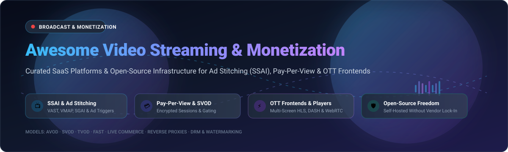

<div align="center">



# Awesome Video Streaming & Monetization 🎬💰

**A curated ecosystem of SaaS platforms, open-source streaming servers, SSAI ad-stitchers, pay-per-view gating engines, and customizable OTT frontends.**

<p align="center">
  <a href="https://github.com/ishandutta2007/Awesome-Awesome-Awesome"></a><a href="https://discord.gg/jc4xtF58Ve"></a>
  <a href="https://github.com/ishandutta2007/Awesome-Video-Streaming-Monetization/stargazers"></a>
  <a href="https://github.com/ishandutta2007/Awesome-Video-Streaming-Monetization/network/members"></a>
  <a href="https://github.com/ishandutta2007/Awesome-Video-Streaming-Monetization/pulls"></a>
  <a href="https://github.com/ishandutta2007/Awesome-Video-Streaming-Monetization/blob/main/LICENSE"></a>
  <a href="https://github.com/ishandutta2007"></a>
</p>

</div>

---

## 📑 Table of Contents

- [📌 Overview & SEO Keyword Focus](#-overview--seo-keyword-focus)
- [📊 Sector Overview & Market Dynamics](#-sector-overview--market-dynamics)
- [🏢 SaaS & Hosted OTT Platforms](#-saas--hosted-ott-platforms)
- [🔓 Open-Source GitHub Projects](#-open-source-github-projects)
- [🏗️ Architectural Blueprint: Building a Self-Hosted Monetization Stack](#️-architectural-blueprint-building-a-self-hosted-monetization-stack)
- [📈 Star History](#-star-history)
- [💖 Support & Sponsorship](#-support--sponsorship)
- [🤝 How to Contribute](#-how-to-contribute)
- [⚖️ Disclaimer & Legal Notices](#️-disclaimer--legal-notices)

---

## 📌 Overview & SEO Keyword Focus

Welcome to the definitive guide and resource directory for **video streaming monetization infrastructure**, **Server-Side Ad Insertion (SSAI)**, **Pay-Per-View (PPV) paywalls**, **Subscription Video on Demand (SVOD)**, and **open-source OTT players**.

Whether you are an independent creator deploying a token-gated live stream, a broadcaster migrating from costly proprietary encoders to transparent HLS/DASH ad-stitchers, or a digital publisher orchestrating FAST (Free Ad-Supported Streaming TV) channels, this repository provides:

- **Actionable comparison data** on commercial SaaS solutions (with exact entry pricing, real free trial constraints, and audited corporate scale).
- **Battle-tested open-source repositories** to audit, host, and control your monetization pipeline without predatory revenue splits.
- **Architectural patterns** for combining low-latency WebRTC/HLS streaming engines with dynamic VAST/VMAP ad stitchers, encrypted session proxies, and paywall gateways.

---

## 📊 Sector Overview & Market Dynamics

The global video streaming and monetization market is estimated at **$156 Billion in 2025** and is projected to expand to **$195+ Billion by 2026**, advancing at a robust Compound Annual Growth Rate (CAGR) of **15% to 21%** toward an addressable market exceeding **$400 Billion by 2030**.

In terms of market structure, the industry exhibits **moderate fragmentation**:
- **Consolidated Layers:** Hyperscale cloud delivery (CDNs such as AWS CloudFront, Cloudflare, Akamai) and mainstream consumer SVOD frontends (Netflix, Disney+, Prime Video) are heavily concentrated.
- **Fragmented Monetization Middleware:** In contrast, the enterprise and creator video monetization stack—spanning Server-Side Ad Insertion (SSAI), dynamic ad replacement, paywalls, microtransactions, white-label OTT web apps, and self-hosted live streaming engines—remains **moderately fragmented**. No single player commands a winner-take-all monopoly. This structural diversity allows nimble SaaS platforms (Uscreen, Dacast, Muvi) and high-performance open-source projects (Ant Media Server, PeerTube, Owncast, Eyevinn Ritcher) to capture substantial market share by offering flexible, unbundled, and self-hosted alternatives to monolithic media suites.

---

## 🏢 SaaS & Hosted OTT Platforms

The following table evaluates the leading commercial SaaS products in the video monetization and streaming sector. The list is sorted in **descending order of company scale** (audited acquisition valuation, market capitalization, or total enterprise funding).

| 🏢 Platform | 📈 Company Scale (Valuation / Revenue) | 🏷️ Specific Starting Pricing | 🎁 Free Tier / Trial Limits | 💳 Monetization Models | 🎯 Target Audience & Key Capabilities |
| :--- | :--- | :--- | :--- | :--- | :--- |
| **[Vimeo OTT](https://vimeo.com/ott)** | **$1.38 Billion** (Acquired by Bending Spoons; ~$417M ARR) | **$1 / subscriber / mo** (Starter Tier; + 10% fee on TVOD rentals/sales) | **30-Day Free Trial** with $0 platform subscriber fees charged during trial period; full web setup | SVOD, TVOD, Subscriptions, Rentals | Independent creators, fitness studios, and boutique media networks launching branded video subscription hubs. |
| **[JW Player](https://www.jwplayer.com)** | **~$300 Million** (Series E; $125M+ funding; ~$80M ARR) | **$10 / mo** (Starter Plan billed annually; HTML5 player & hosting) | **Free Developer Tier** (5,000 video plays/mo, 25 GB storage, 50 GB streaming) or **30-Day Enterprise Trial** | AVOD (SSAI/CSAI), VAST, VMAP, Google IMA, FAST | Publishers and digital media platforms requiring high-volume HTML5 playback with programmatic video ad insertion. |
| **[Uscreen](https://www.uscreen.tv)** | **~$256 Million** ($150M majority growth funding from PSG Equity; $1B+ creator GMV) | **$49 / mo** (Starter Plan) or **$149 / mo** + $1.99/active subscriber (Growth Plan) | **14-Day Free Trial** (Full dashboard access, unlimited video uploads, storefront paywall testing; no credit card required) | SVOD, TVOD, Live Streaming Paywalls, Community Subscriptions | EdTech creators, fitness influencers, and digital brands seeking an all-in-one membership portal with branded mobile & TV apps. |
| **[Brightcove](https://www.brightcove.com)** | **$233 Million** (Acquired by Bending Spoons; ~$199M ARR) | **$1,666 / mo** (~$20,000/year minimum baseline contract for SMB Marketing Studio) | **30-Day Proof-of-Concept (PoC)** upon sales qualification (Sandbox limited to 5 video uploads and player analytics) | AVOD (SSAI/SGAI), SVOD, TVOD, Live DRM Pay-Per-View | Broadcasters, Tier-1 enterprise marketing teams, and multinational publishers needing carrier-grade OTT and SSAI pipelines. |
| **[Kaltura](https://corp.kaltura.com)** | **$213 Million** (NASDAQ: `KLTR`; ~$181M ARR) | **$19 / mo** (Virtual Classroom entry) or **$0.0015/min** API transcoding | **14-Day Free Trial** (Full classroom/webinar room access) plus **$100 Free API Developer Credit** (valid 30 days) | SVOD, AVOD, Paywalled Webinars, Pay-As-You-Go Video APIs | Universities, enterprises, telecom operators, and developers combining open-source core flexibility with enterprise cloud APIs. |
| **[Dacast](https://www.dacast.com)** | **~$30 Million** (~$15M ARR bootstrapped) | **$39 / mo** (Starter Plan billed annually; includes 2.4 TB bandwidth/yr & 500 GB storage) | **14-Day Free Trial** (Includes 10 GB bandwidth, live paywall setup, and broadcasting test; no credit card required) | Pay-Per-View (PPV), Subscriptions, Player Ads (VAST/VMAP) | Live sports organizers, event broadcasters, houses of worship, and SMB media creators monetizing real-time streams. |
| **[Muvi One](https://www.muvi.com)** | **~$25 Million** (~$10M ARR) | **$399 / mo** (Standard Tier for white-labeled website and mobile/TV apps) | **14-Day Free Trial** (Full access to admin CMS, multi-screen app previews, and transcoding; no credit card required) | SVOD, AVOD, TVOD, PPV, FAST Channels | Media distributors, film festivals, and enterprise content owners launching end-to-end multi-device OTT platforms without coding. |

---

## 🔓 Open-Source GitHub Projects

Explore the top open-source projects providing self-hosted streaming, ad-stitching, paywalls, and video players. All repositories are **ranked in descending order of GitHub star counts**, with direct star badges linking to each repository's stargazers community.

### 1. [PeerTube](https://github.com/Chocobozzz/PeerTube) [](https://github.com/Chocobozzz/PeerTube/stargazers)
- **Primary Focus:** Decentralized, federated video streaming platform powered by ActivityPub and WebTorrent/HLS P2P.
- **Monetization Mechanics:** Built-in support for creator tips and donations (PayPal, Liberapay, Tipeee), Web Monetization API / Coil integration for streaming micropayments, and third-party monetization plugins for subscription-gated video nodes.
- **License:** AGPL-3.0.
- **Best For:** Content platforms and organizations wanting autonomous video hosting that eliminates central server bandwidth costs through peer-to-peer distribution.

### 2. [Owncast](https://github.com/owncast/owncast) [](https://github.com/owncast/owncast/stargazers)
- **Primary Focus:** Standalone, self-hosted live video and interactive web chat server.
- **Monetization Mechanics:** Native creator monetization features baked into the chat interface: integrated tipping triggers, outbound donation cards (Buy Me a Coffee, Patreon, Liberapay, PayPal), and customizable channel support actions without platform cuts.
- **License:** MIT.
- **Best For:** Streamers and live broadcasters seeking complete ownership over their audience, data, chat community, and financial contributions.

### 3. [Restreamer](https://github.com/datarhei/restreamer) [](https://github.com/datarhei/restreamer/stargazers)
- **Primary Focus:** Full-featured live video streaming suite with an intuitive web GUI for HLS, RTMP, and SRT ingestion and delivery.
- **Monetization Mechanics:** Broadcast restreaming to monetized third-party platforms (YouTube, Twitch, Kick) simultaneously; customizable graphic overlays for sponsors, promotional call-to-action cards, and iframe embed gating for paid paywall landing pages.
- **License:** GPL-3.0.
- **Best For:** Broadcasters and event organizers requiring a zero-maintenance self-hosted restreaming hub and player embed solution.

### 4. [Ant Media Server](https://github.com/ant-media/Ant-Media-Server) [](https://github.com/ant-media/Ant-Media-Server/stargazers)
- **Primary Focus:** Ultra-low latency streaming engine with WebRTC (~0.5s latency), SRT, RTMP, HLS, CMAF, and adaptive bitrate transcoding.
- **Monetization Mechanics:** Webhook-driven pay-per-view access authorization, tokenized stream security to prevent unauthorized viewer hotlinking, and single-source simulcasting to monetized social destinations.
- **License:** Apache 2.0 (Community Edition).
- **Best For:** Real-time interactive broadcasting, virtual auctions, live education, and developers needing a dependable, upgradeable live engine.

### 5. [OvenMediaEngine](https://github.com/OvenMediaLabs/OvenMediaEngine) [](https://github.com/OvenMediaLabs/OvenMediaEngine/stargazers)
- **Primary Focus:** Sub-second ultra-low latency streaming server delivering WebRTC and Low-Latency HLS (LL-HLS).
- **Monetization Mechanics:** Purpose-built for time-sensitive, highly monetizable interactive streaming: live shopping / e-commerce checkout synchronization, micro-betting overlays, live esports pay-per-view, and real-time bidder engagement.
- **License:** GPL-2.0.
- **Best For:** High-concurrency platforms where sub-second latency directly determines transaction conversion rates and paywall retention.

### 6. [AVideo](https://github.com/WWBN/AVideo) [](https://github.com/WWBN/AVideo/stargazers)
- **Primary Focus:** Comprehensive open-source audio/video sharing and live streaming CMS (self-hosted YouTube/Netflix alternative).
- **Monetization Mechanics:** Fully developed native monetization ecosystem: Pay-Per-View video sales, recurring membership subscriptions (SVOD), video ad insertion using VAST/VMAP protocols, internal user wallets, and creator payout splits.
- **License:** GPL-3.0.
- **Best For:** Creators and digital media enterprises wanting an out-of-the-box self-hosted video portal with native payment and ad monetization capabilities.

### 7. [OpenPlayerJS](https://github.com/openplayerjs/openplayerjs) [](https://github.com/openplayerjs/openplayerjs/stargazers)
- **Primary Focus:** Modular, zero-dependency, lightweight HTML5 video and audio player with first-class ad monetization plugins.
- **Monetization Mechanics:** Native VAST/VMAP/VPAID and non-linear companion ad plugin using open-source parsing libraries instead of the heavy Google IMA SDK, eliminating client-side tracker blocking and geographic restrictions.
- **License:** MIT.
- **Best For:** Front-end engineers who want complete control over player UI, fast load times, and independent video ad revenue collection.

### 8. [Livepeer](https://github.com/livepeer/go-livepeer) [](https://github.com/livepeer/go-livepeer/stargazers)
- **Primary Focus:** Decentralized live and on-demand video transcoding network orchestrated by smart contracts.
- **Monetization Mechanics:** Dramatically reduces video delivery infrastructure costs (by up to 80%) through open marketplace economics, enabling developers to build token-gated paywalls, web3 micropayments, and decentralized video apps.
- **License:** MIT.
- **Best For:** Video application founders seeking radically lower video transcoding costs and decentralized media protocol primitives.

### 9. [videojs-contrib-ads](https://github.com/videojs/videojs-contrib-ads) [](https://github.com/videojs/videojs-contrib-ads/stargazers)
- **Primary Focus:** The foundational ad framework and state machine for Video.js, the web's most prevalent video player.
- **Monetization Mechanics:** Standardizes ad request lifecycles, preroll/midroll/postroll cue points, ad timeout handling, and content-to-ad stream switching for any ad provider (Google IMA, FreeWheel, SpotX, SpringServe).
- **License:** Apache 2.0.
- **Best For:** Publishers and developers integrating ad insertion mechanisms into existing Video.js player implementations.

### 10. [JW OTT Webapp](https://github.com/jwplayer/ott-web-app) [](https://github.com/jwplayer/ott-web-app/stargazers)
- **Primary Focus:** Open-source reference OTT web application designed for multi-device video delivery.
- **Monetization Mechanics:** Pre-configured workflows for ad-supported (AVOD) and subscription-based (SVOD) revenue models, user registration and login gating, Electronic Program Guides (EPG), and live stream access controls.
- **License:** Apache 2.0.
- **Best For:** Broadcasters and video publishers on JW Player looking for a production-ready, customizable frontend without building from scratch.

### 11. [PPV Stream (Rust)](https://github.com/kukuhtw/ppv_stream_rust) [](https://github.com/kukuhtw/ppv_stream_rust/stargazers)
- **Primary Focus:** High-performance, secure pay-per-view video streaming engine built with Rust and HLS.
- **Monetization Mechanics:** Direct pay-per-view pricing set by creators, multi-currency support, internal wallet for deposit/withdrawal management, automated affiliate and referral commission distribution, and dynamic anti-piracy video watermarks.
- **License:** MIT.
- **Best For:** Independent creators, coaches, and exclusive broadcasters who want self-hosted pay-per-view infrastructure without platform revenue share.

### 12. [OCF (Open Container Format)](https://github.com/arcnmx/ocf-rs) [](https://github.com/arcnmx/ocf-rs/stargazers)
- **Primary Focus:** Cryptographically secure container specification for gated media and sensitive content distribution.
- **Monetization Mechanics:** Clean-room implementation using AES-256-GCM authenticated encryption, Argon2id key derivation, and Ed25519 digital signatures to enforce access policies (expiration dates, machine binding, play limits) on premium downloadable video files.
- **License:** Apache 2.0 / MIT.
- **Best For:** Platforms needing client-side policy-gated video protection to deter casual sharing and piracy of premium instructional or entertainment assets.

### 13. [Eyevinn Ritcher](https://github.com/JoeldelPilar/ritcher) [](https://github.com/JoeldelPilar/ritcher/stargazers)
- **Primary Focus:** High-throughput Rust-based ad stitcher engineered specifically for HLS and DASH streams.
- **Monetization Mechanics:** Supports Server-Side Ad Insertion (SSAI) with on-the-fly segment substitution and Server-Guided Ad Insertion (SGAI) via HLS Interstitial `EXT-X-DATERANGE` tags. Integrates seamlessly with VAST-compliant ad decision servers and Valkey/Redis session stores.
- **License:** MIT.
- **Best For:** Streaming engineers and FAST channel operators needing an open-source, vendor-agnostic SSAI ad-stitching engine.

---

## 🏗️ Architectural Blueprint: Building a Self-Hosted Monetization Stack

Below is a reference architectural pattern illustrating how to assemble an end-to-end video streaming and monetization pipeline using open-source tools:

```
[ Camera / OBS / RTMP Source ]
               │
               ▼
   [ Ingestion & Transcoding ] ────► Ant Media Server / OvenMediaEngine
               │                      (Outputs pristine multi-bitrate HLS / DASH)
               ▼
    [ Ad Stitching & Proxy ]   ────► Eyevinn Ritcher / Custom Reverse Proxy
               │                      (Injects VAST ads via SSAI or SGAI Interstitials)
               ▼
   [ Authentication & Paywall] ────► PPV Stream Engine / Stripe Webhook Gateway
               │                      (Validates user session, token & DRM keys)
               ▼
    [ Multi-Screen Player ]    ────► OpenPlayerJS / Video.js + videojs-contrib-ads
               │                      (Plays stream smoothly, renders companion ads)
               ▼
[ End Viewer (Mobile / Web / TV) ]
```

---

## 📈 Star History

[](https://star-history.dera.page/#ishandutta2007/Awesome-Video-Streaming-Monetization&type=date&legend=top-left)

---

## 💖 Support & Sponsorship

If you found this ecosystem guide helpful in navigating the video streaming and monetization landscape, please consider supporting the project:

- ⭐ **Star this repository** to improve discoverability for creators and streaming engineers.
- 🍴 **Fork the repo** to benchmark and extend tools for your personal or enterprise stack.
- 📢 **Share with your network** on LinkedIn, X/Twitter, Discord, or Reddit.
- ☕ **Buy a coffee & sponsor ongoing maintenance:**  
  👉 **[Sponsor Dashboard on GitHub](https://github.com/sponsors/ishandutta2007)**

Your support directly funds continuous market tracking, documentation audits, and the addition of new open-source video infrastructure projects!

---

## 🤝 How to Contribute

Contributions from developers, broadcasters, ad tech specialists, and streaming architects are warmly welcomed:

1. 🍴 **Fork this repository**.
2. 🌿 **Create a descriptive branch** (`git checkout -b feature/add-new-streaming-tool`).
3. 📝 **Add or update your entry** in `README.md` following the established table or badge conventions:
   - For SaaS tools: include verified company valuation/scale, specific starting tier price, and concrete trial limits.
   - For Open-Source tools: include the linked social star badge `[](https://github.com/owner/repo/stargazers)`.
4. 🚀 **Submit a Pull Request** with a succinct explanation of why the tool is valuable for video monetization.

---

## ⚖️ Disclaimer & Legal Notices

- This repository is a community-curated educational and informational resource. Product names, logos, trademarks, and registered trademarks cited herein remain the property of their respective owners.
- **Streaming Cost Notice:** Self-hosting open-source video infrastructure transfers egress, transcoding, and storage expenses directly to your cloud provider (e.g., AWS S3, Cloudflare R2, Akamai). High-concurrency live events require rigorous CDN caching configuration to prevent unforeseen egress bills.
- **Client-Side Security:** DRM and container formats like OCF raise the barrier against casual redistribution but cannot prevent extraction by an attacker who controls the playback runtime memory and decryption keys. Always layer token authorization and dynamic watermarking for premium content.

---

<div align="center">
  <sub>Maintained with ❤️ by <a href="https://github.com/ishandutta2007">Ishan Dutta</a> and the open-source streaming community.</sub>
</div>
